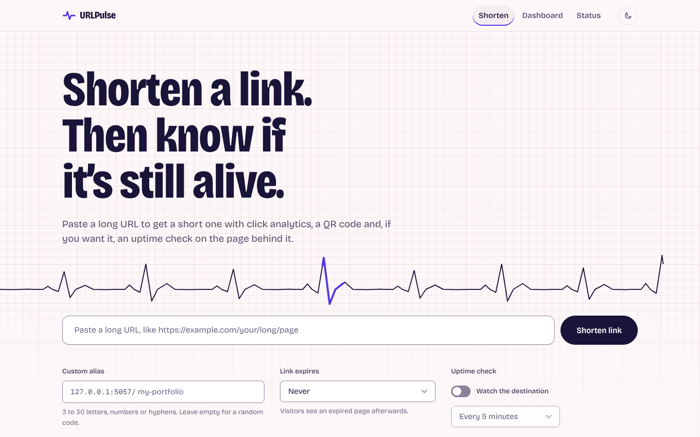
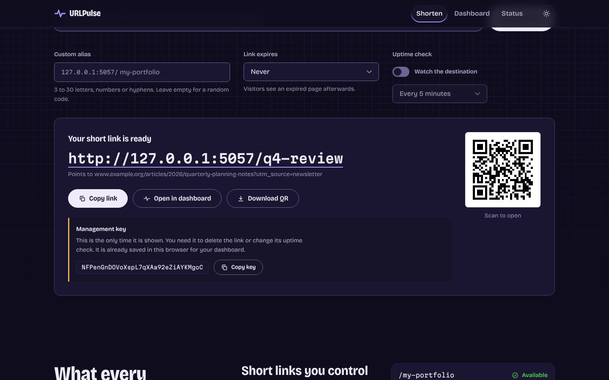
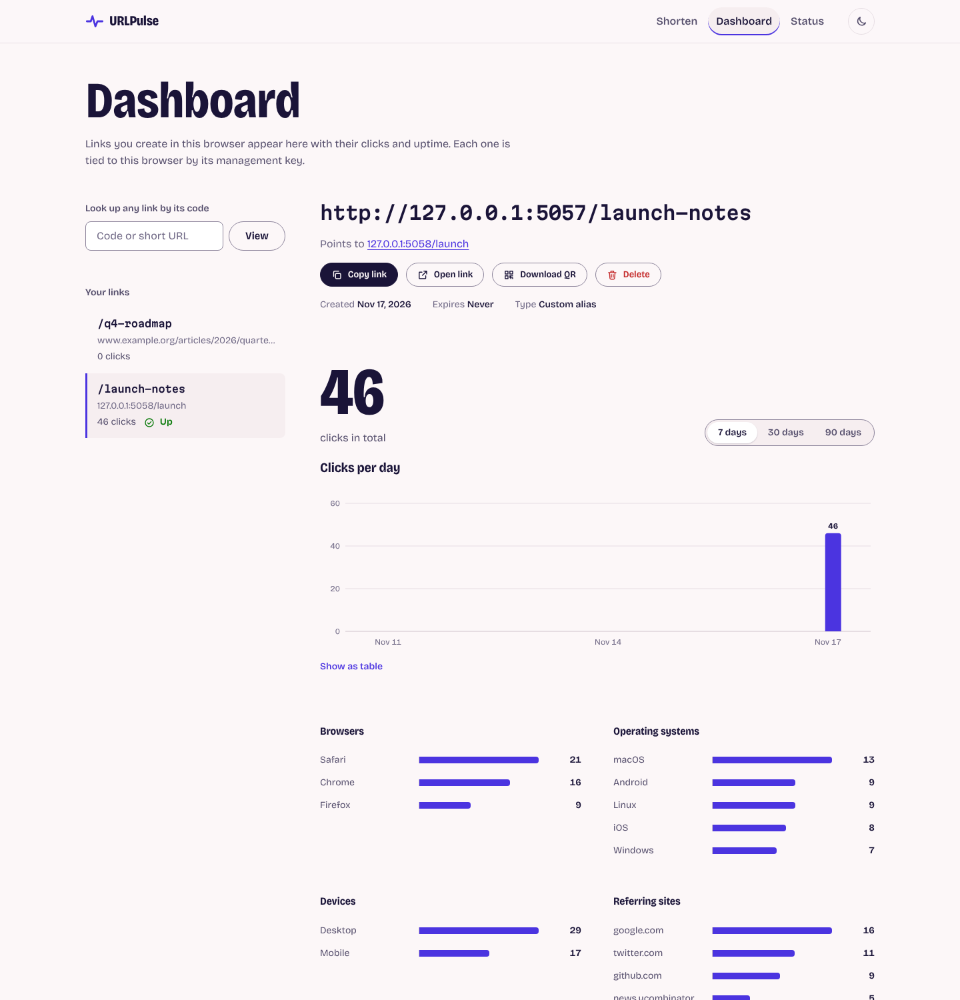
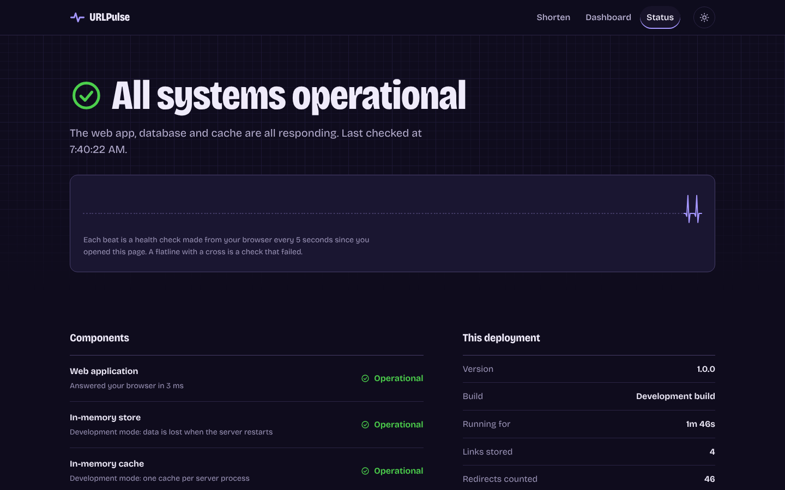

# URLPulse

**Shorten a link. Then know if it's still alive.**

URLPulse is an automated URL shortener with built-in uptime monitoring, click analytics and a complete CI/CD pipeline. Paste a long URL, get a short one (random code or your own alias, optional expiry, QR code), and switch on an uptime check to watch the page behind it. No account needed.

It is also a DevOps capstone: containers, a pipeline with security gates, Prometheus and Grafana, runbooks, rollback and backups, all around a real application with a website designed to be shown off.

| | |
|---|---|
|  |  |
|  |  |

## Features

- Short links with a random 7-character code or a custom alias, optional expiry, QR code.
- Click analytics (totals, daily series, browser, operating system, device and referrer breakdowns). IP addresses are salted and hashed before storage; no cookies.
- Uptime monitoring per link (30 s scheduler tick, 5 min default interval), with a public status page and per-link history.
- SSRF protection on destinations and probes, rate limiting, a strict Content Security Policy.
- Light and dark website: shorten, dashboard, status.

## Architecture

```
Docker Compose (primary demo)                      Render (public demo)
browser ─▶ nginx ─▶ app ─▶ MongoDB                 browser ─▶ Render HTTPS edge ─▶ app (one Docker web service)
                     ├────▶ Redis (cache)                                          └─▶ MongoDB Atlas (free)
          Prometheus ─▶ app /metrics                                                  in-memory cache (CACHE=memory)
          Grafana ─▶ Prometheus
```

- **Compose** runs six services: nginx, the app, MongoDB, Redis, Prometheus and Grafana. This is the full system.
- **Render** runs the same Docker image built from this repository as one web service, with MongoDB Atlas for storage and the in-process memory cache instead of Redis. Render supplies HTTPS and its own proxy, so there is no nginx there. Prometheus and Grafana are local-only (Compose) and are not deployed to Render.
- **Kubernetes** manifests exist under `k8s/` as an optional extra. They have been written and statically checked only; they have not been applied to a cluster.

## Tech stack

Node.js 22+ (CI runs 22 and 24), Express 5, Mongoose/MongoDB, Redis via ioredis (optional), prom-client, pino, helmet, express-rate-limit. Website: plain HTML, CSS and ES modules. Containers: multi-stage, non-root image. CI/CD: GitHub Actions. Monitoring: Prometheus and Grafana.

## Run it

**Without Docker** (in-memory storage and cache, nothing else to install):

```bash
npm ci
npm run dev                 # http://localhost:5000
```

**Whole stack with Docker Compose:**

```bash
make up                     # creates .env with generated secrets on first run, then starts all six services
make smoke                  # end-to-end check against the running stack
make down                   # stop, keep data
```

| Service | URL | Notes |
|---|---|---|
| Website and API (nginx) | http://localhost:8082 | `HTTP_PORT` changes the host port (the container listens on 8080) |
| Grafana | http://localhost:3001 | Login is printed once by `make init` |
| Prometheus | http://localhost:9090 | Bound to loopback |
| App directly, bypassing nginx | http://127.0.0.1:5003 | Dev override only (`docker-compose.override.yml`) |

`make` lists every shortcut. Docker Desktop (or Docker Engine with the Compose plugin) is required for the stack.

## Configuration

Copy `.env.example` to `.env` (or run `make init`, which also generates the secrets). `.env` is git-ignored: never commit it. The complete variable list is in [BACKEND_DESIGN.md, section 7](docs/design/BACKEND_DESIGN.md#7-configuration-reference). The ones that matter:

| Variable | Purpose |
|---|---|
| `MONGO_URI` / `REDIS_URL` | Storage and cache. Absent means in-memory mode |
| `HASH_SALT` | Required in production (16+ characters) |
| `BASE_URL` | Public origin used to build short links. **Set it when deployed**, otherwise it is derived from the request `Host` header |
| `TRUST_PROXY` | Number of proxies in front of the app (`1` behind the Compose nginx; the Render service is configured with `1`, which is the expected value but still to be confirmed there, see the Render section). Controls client-IP detection, so it affects rate limiting |
| `METRICS_TOKEN` | Optional bearer token for `/metrics` |
| `CORS_ORIGIN` | Off by default. Comma-separated explicit origins only; `*` is refused at start-up |
| `RATE_LIMIT_MAX`, `READ_RATE_LIMIT_MAX`, `PUBLIC_RATE_LIMIT_MAX` | Write, read and public-route (redirect, pages, 404) limits |

## Tests

```bash
npm run lint
npm test                    # unit and integration tests, in memory
npm run test:coverage       # with coverage thresholds
npm run test:e2e            # needs MONGO_URI and REDIS_URL, see jest.e2e.config.js (skips itself otherwise)
make smoke                  # against a running instance
node scripts/ui-check.js    # headless-browser check of the website (needs playwright)
```

## CI/CD

GitHub Actions (`.github/workflows/ci-cd.yml`), on pushes and pull requests to `main`:

1. **test**: lint, unit and integration tests with coverage thresholds, end-to-end tests against real MongoDB and Redis service containers, dependency audit; Node 22 and 24.
2. **image**: build the image, Trivy scan (fails on fixable critical vulnerabilities), start the container and smoke-test it.
3. **publish** (`main` only): multi-architecture image to Docker Hub as `<user>/urlpulse` with `sha-<commit>` and `latest` tags, plus SBOM and provenance.
4. **deploy** (optional, off unless `DEPLOY_ENABLED=true`): SSH to a server and run `scripts/deploy.sh` with automatic rollback. **This is not how the Render demo is deployed.**

CodeQL scans JavaScript on every push and weekly; Dependabot keeps npm, Docker and Actions current.

## Render deployment

The Render service is a free Docker web service built from this repository's `Dockerfile` (not pulled from Docker Hub), with Auto-Deploy set to *After CI Checks Pass* on `main`, so a push to `main` deploys only after the GitHub Actions checks succeed. Storage is MongoDB Atlas (free tier).

Required settings on Render (names only; set values in the Render dashboard, never in the repository): `NODE_ENV=production`, `STORAGE=mongo`, `MONGO_URI`, `HASH_SALT`, `CACHE=memory`, `TRUST_PROXY=1`, `MONITOR_ENABLED=true`, `METRICS_TOKEN`, **`BASE_URL`** (the public `https://...onrender.com` address, so short links and QR codes use it rather than the request `Host`).

Free-tier limits to know: the service sleeps after about 15 minutes without inbound requests and monitoring only runs while it is awake; the first request after a sleep is slow; the in-memory cache and rate-limit counters reset on every restart. The full list and a verification procedure are in [DEVOPS_RUNBOOK.md, section 13](docs/design/DEVOPS_RUNBOOK.md#13-render-deployment).

## Monitoring

`/livez` and `/health` (JSON status, dependency state, commit and version) are available everywhere. `/metrics` (Prometheus format) is served by the app, protected by `METRICS_TOKEN` if set, and blocked at the Compose nginx. Prometheus (13 alert rules) and the provisioned 24-panel Grafana dashboard run **locally in Compose only**. There is no Alertmanager, so alerts are visible in Prometheus but are not sent anywhere.

## Documentation

Start with **[DOCUMENTATION.md](DOCUMENTATION.md)**, the single source of truth: architecture, decisions, security, scaling, CI/CD, requirements traceability, roadmap, and a dated table of what has and has not been verified.

| Deep dive | Topic |
|---|---|
| [docs/design/BACKEND_DESIGN.md](docs/design/BACKEND_DESIGN.md) | Server design, data model, full API, every setting |
| [docs/design/WEBSITE_SPEC.md](docs/design/WEBSITE_SPEC.md) | Every page, state and string |
| [docs/design/DESIGN_SYSTEM.md](docs/design/DESIGN_SYSTEM.md) | Colour, type, components, charts, accessibility |
| [docs/design/OBSERVABILITY.md](docs/design/OBSERVABILITY.md) | Health, metrics, logs, alerts, dashboard |
| [docs/design/DEVOPS_RUNBOOK.md](docs/design/DEVOPS_RUNBOOK.md) | Set-up, deploy, rollback, backup, HTTPS, Render, troubleshooting |

## Project status

As of 2026-11-20: lint is clean and 175 unit and integration tests pass locally; the GitHub Actions run for commit `cf8d186` passed on Node 22 and 24 (including end-to-end tests against real MongoDB and Redis), built and scanned the image, smoke-tested the container and published it to Docker Hub; the app runs on Render against MongoDB Atlas. Not yet verified: restoring a backup, a Kubernetes deployment, the Render per-client IP detection, and a few other items listed with their status in [DOCUMENTATION.md, Verification status](DOCUMENTATION.md#verification-status).

## Licence

MIT. Fonts are under the SIL Open Font License (see `public/assets/fonts/`).
